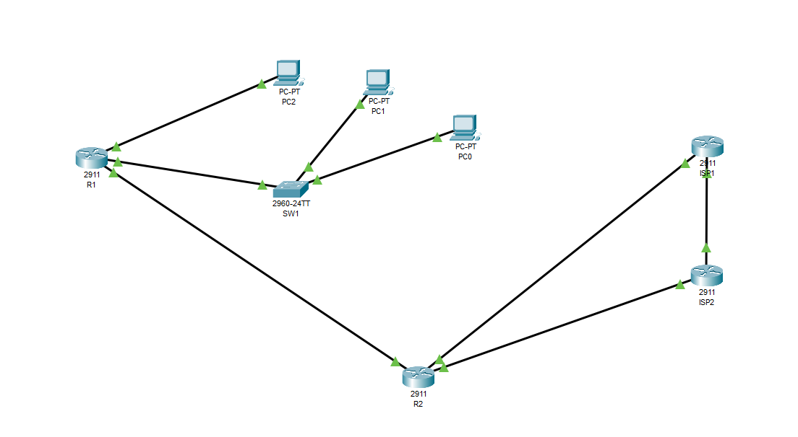
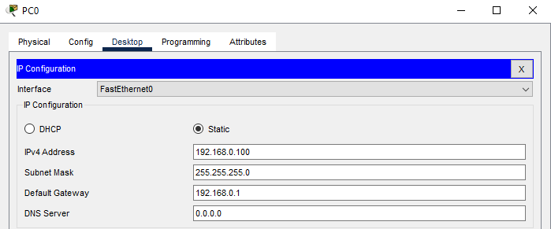
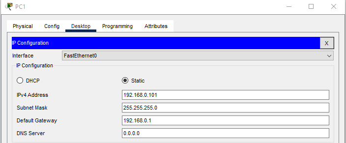
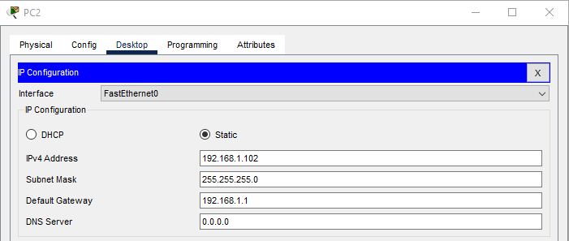
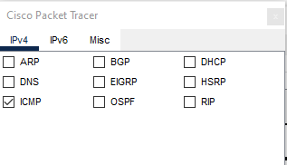
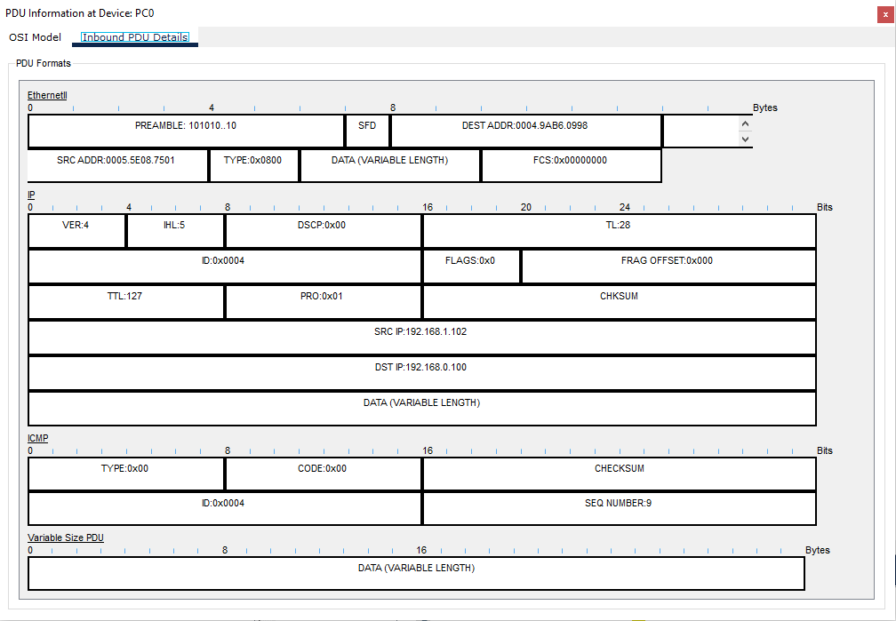
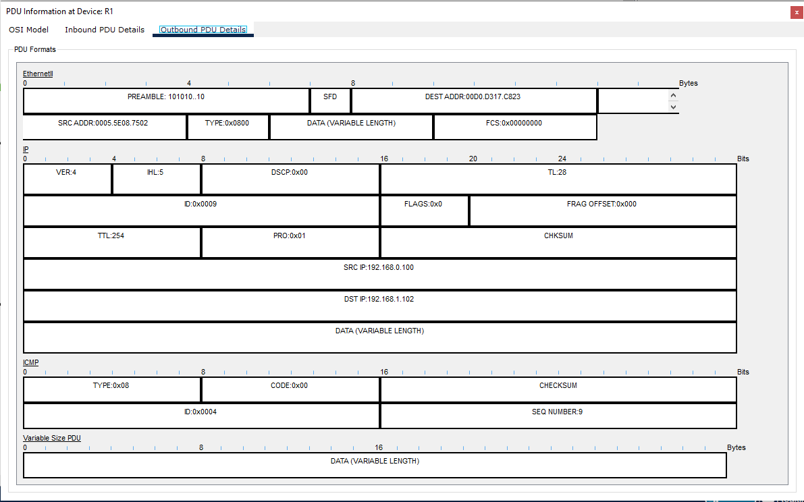

# Отчет по лабораторной работе 1.1
**Тема:** Базовая настройка, ARP, статическая маршрутизация  
**Выполнил:** Маржинэ А. Г., гр. 409 
## Часть 1: Создание топологии и начальная конфигурация устройств
### Шаг 1

Настроили IP-адреса маски и шлюзы на компьютерах `PC0`,`PC1`,`PC2`



Через консоль выполнили базовую настройку `R1`, `R2` и `SW1` (задали hostname, пароли, шифрование, параметры консоли и IP на интерфейсах), после чего сохранили конфиг.
```
Building configuration...

Current configuration : 967 bytes
!
version 15.1
no service timestamps log datetime msec
no service timestamps debug datetime msec
service password-encryption
!
hostname R1
!
!
!
enable secret 5 $1$mERr$hx5rVt7rPNoS4wqbXKX7m0
!
!
!
!
!
!
ip cef
no ipv6 cef
!
!
!
username admin privilege 15 secret 5 $1$mERr$hx5rVt7rPNoS4wqbXKX7m0
!
!
license udi pid CISCO2911/K9 sn FTX1524FM70-
!
!
!
!
!
!
!
!
!
no ip domain-lookup
!
!
spanning-tree mode pvst
!
!
!
!
!
!
interface GigabitEthernet0/0
 description LAN1
 ip address 192.168.0.1 255.255.255.0
 duplex auto
 speed auto
!
interface GigabitEthernet0/1
 description LAN2
 ip address 192.168.1.1 255.255.255.128
 duplex auto
 speed auto
!
interface GigabitEthernet0/2
 description UPLINK
 ip address 10.10.12.2 255.255.255.252
 duplex auto
 speed auto
!
interface Vlan1
 no ip address
 shutdown
!
ip classless
!
ip flow-export version 9
!
!
!
!
!
!
!
line con 0
 speed 115200
 logging synchronous
 login local
!
line aux 0
!
line vty 0 4
 login
!
!
!
end
```
### Шаг 2
Проверили доступность узлов командой `ping` с `PC0` до `PC1` и `PC2`. Посмотрели таблицы MAC на `SW1` и ARP на `PC0` и `R1`.
```
SW1#show mac address-table 
          Mac Address Table
-------------------------------------------

Vlan    Mac Address       Type        Ports
----    -----------       --------    -----

   1    0004.9ab6.0998    DYNAMIC     Fa0/10
   1    0005.5e08.7501    DYNAMIC     Gig0/1
   1    00d0.58aa.a743    DYNAMIC     Fa0/11
```
```C:\>arp -a
  Internet Address      Physical Address      Type
  192.168.0.1           0005.5e08.7501        dynamic
  192.168.0.101         00d0.58aa.a743        dynamic```
  ```R1#show ip arp 
Protocol  Address          Age (min)  Hardware Addr   Type   Interface
Internet  10.10.12.2              -   0005.5E08.7503  ARPA   GigabitEthernet0/2
Internet  192.168.0.1             -   0005.5E08.7501  ARPA   GigabitEthernet0/0
Internet  192.168.0.100           8   0004.9AB6.0998  ARPA   GigabitEthernet0/0
Internet  192.168.1.1             -   0005.5E08.7502  ARPA   GigabitEthernet0/1
Internet  192.168.1.102           8   00D0.D317.C823  ARPA   GigabitEthernet0/1
```
**Ответы на вопросы:**
1. [C PC0 до PC1 пинг прошел,с PC0 до PC2 не прошел]
2. [В таблице указаны MAC адреса устройств,которые подключены к нему и так же показывает их порты]
3. [В таблице ARP на PC0 видно IP и MAC адрес 2-х устройств:PC1 и R1]
## Часть 2: Роль IP и MAC адреса при прямой и косвенной пересылке
### Шаг 1
Перешли в режим симуляции, настроили фильтр на протокол `ICMP` и отправили пинг с `PC0` на `PC2`.

### Шаг 2
Открыли пакет на `PC0` и изучили заголовки.

* **DEST MAC:** [0004.9AB6.0998,Это MAC адрес R1,PC2 находится в другой подсети и поэтому PC0 обратился к R1 (шлюзу),R1 увидел IP адрес устройства и знает его MAC и отправляет дальше ему,но в пакете уже был бы другой MAC адрес,потому что при переходе пакета от устройства к устройству IP адрес не меняется,но MAC адрес будет меняться на устройство которому будет следующая передача]
Сделали симуляцию до `R1` и открыли `Outbound PDU Details`

* **SRC и DEST MAC:** [0005.5E08.7502 00D0.D317.C823,Мы видим MAC адреса R1 и PC2,как описывалось в прошлом тексте,пакет попал на другое устройство и MAC адреса отправителя и назначения поменялись,изначально был указан MAC PC0 до IP PC2,этот пакет отправляется на R1 и он видит IP назначения и благодаря таблице ARP знает что этот IP принадлежит MAC адресу PC2 и отправляет его туда от себя,при этом IP адреса не меняются,они остаются изначальными]
