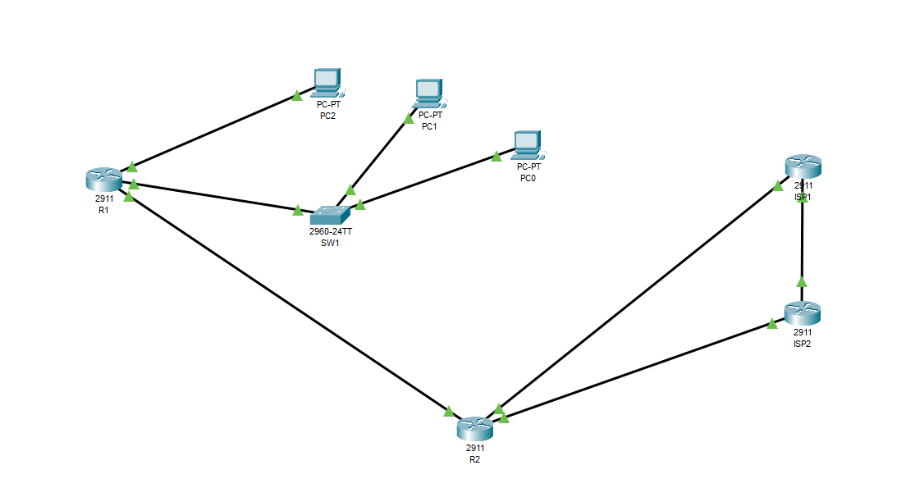
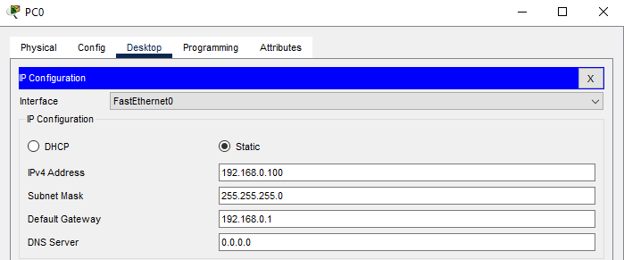
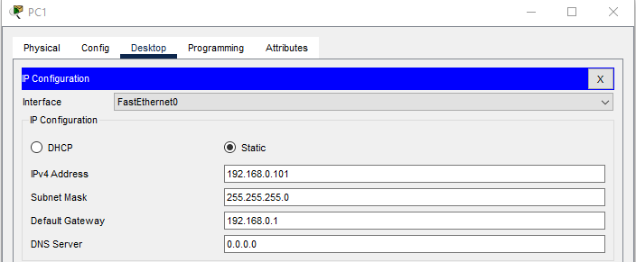
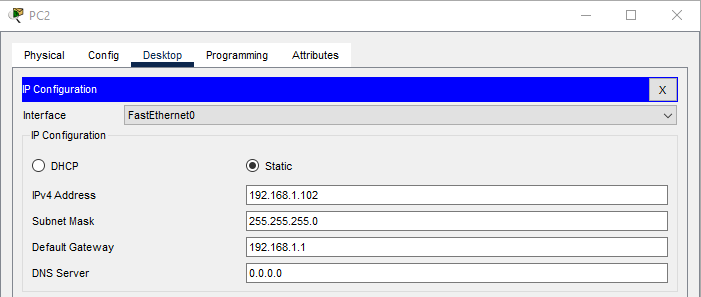
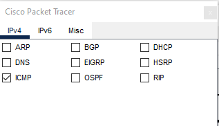
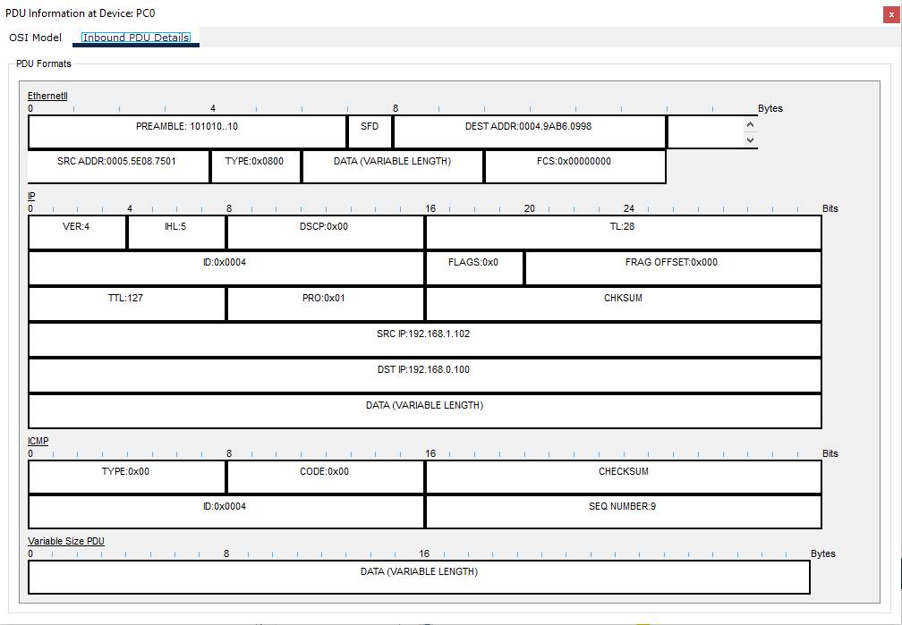
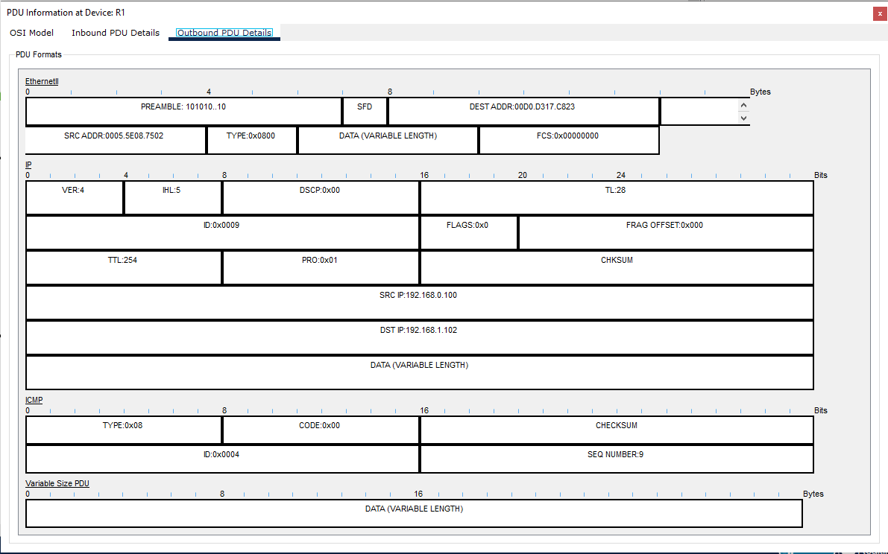
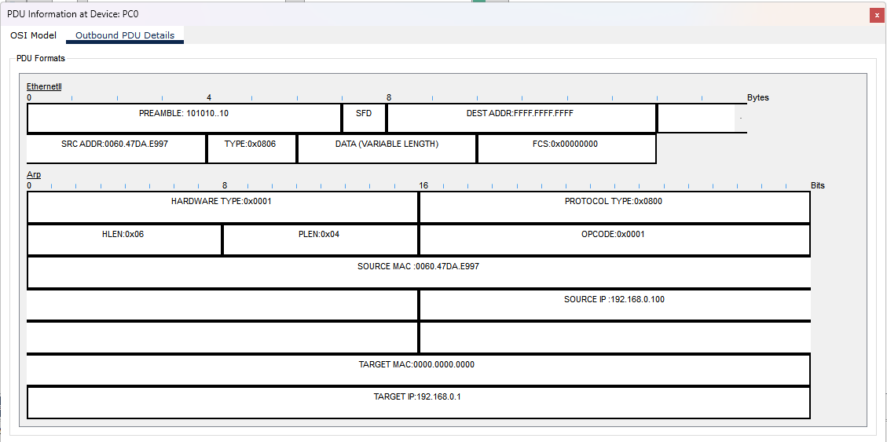
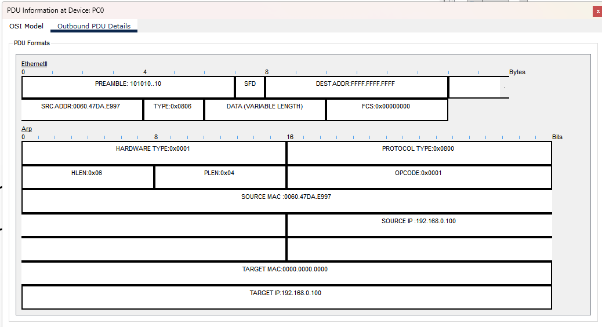
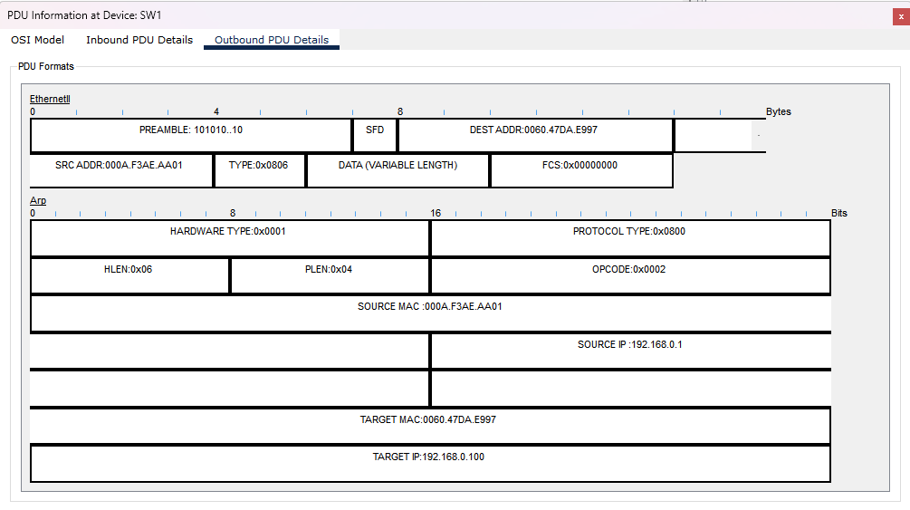

# Отчет по лабораторной работе 1.1
**Тема:** Базовая настройка, ARP, статическая маршрутизация  
**Выполнил:** Маржинэ А. Г., гр. 409 
## Часть 1: Создание топологии и начальная конфигурация устройств
### Шаг 1

Настроили IP-адреса маски и шлюзы на компьютерах `PC0`,`PC1`,`PC2`



Через консоль выполнили базовую настройку `R1`, `R2` и `SW1` (задали hostname, пароли, шифрование, параметры консоли и IP на интерфейсах), после чего сохранили конфиг.
```
Building configuration...

Current configuration : 967 bytes
!
version 15.1
no service timestamps log datetime msec
no service timestamps debug datetime msec
service password-encryption
!
hostname R1
!
!
!
enable secret 5 $1$mERr$hx5rVt7rPNoS4wqbXKX7m0
!
!
!
!
!
!
ip cef
no ipv6 cef
!
!
!
username admin privilege 15 secret 5 $1$mERr$hx5rVt7rPNoS4wqbXKX7m0
!
!
license udi pid CISCO2911/K9 sn FTX1524FM70-
!
!
!
!
!
!
!
!
!
no ip domain-lookup
!
!
spanning-tree mode pvst
!
!
!
!
!
!
interface GigabitEthernet0/0
 description LAN1
 ip address 192.168.0.1 255.255.255.0
 duplex auto
 speed auto
!
interface GigabitEthernet0/1
 description LAN2
 ip address 192.168.1.1 255.255.255.128
 duplex auto
 speed auto
!
interface GigabitEthernet0/2
 description UPLINK
 ip address 10.10.12.2 255.255.255.252
 duplex auto
 speed auto
!
interface Vlan1
 no ip address
 shutdown
!
ip classless
!
ip flow-export version 9
!
!
!
!
!
!
!
line con 0
 speed 115200
 logging synchronous
 login local
!
line aux 0
!
line vty 0 4
 login
!
!
!
end
```
### Шаг 2
Проверили доступность узлов командой `ping` с `PC0` до `PC1` и `PC2`. Посмотрели таблицы MAC на `SW1` и ARP на `PC0` и `R1`.
```
SW1#show mac address-table 
          Mac Address Table
-------------------------------------------

Vlan    Mac Address       Type        Ports
----    -----------       --------    -----

   1    0004.9ab6.0998    DYNAMIC     Fa0/10
   1    0005.5e08.7501    DYNAMIC     Gig0/1
   1    00d0.58aa.a743    DYNAMIC     Fa0/11
```
```C:\>arp -a
  Internet Address      Physical Address      Type
  192.168.0.1           0005.5e08.7501        dynamic
  192.168.0.101         00d0.58aa.a743        dynamic```
  ```R1#show ip arp 
Protocol  Address          Age (min)  Hardware Addr   Type   Interface
Internet  10.10.12.2              -   0005.5E08.7503  ARPA   GigabitEthernet0/2
Internet  192.168.0.1             -   0005.5E08.7501  ARPA   GigabitEthernet0/0
Internet  192.168.0.100           8   0004.9AB6.0998  ARPA   GigabitEthernet0/0
Internet  192.168.1.1             -   0005.5E08.7502  ARPA   GigabitEthernet0/1
Internet  192.168.1.102           8   00D0.D317.C823  ARPA   GigabitEthernet0/1
```
**Ответы на вопросы:**
1. [C PC0 до PC1 пинг прошел,с PC0 до PC2 не прошел]
2. [В таблице указаны MAC адреса устройств,которые подключены к нему и так же показывает их порты]
3. [В таблице ARP на PC0 видно IP и MAC адрес 2-х устройств:PC1 и R1]
## Часть 2: Роль IP и MAC адреса при прямой и косвенной пересылке
### Шаг 1
Перешли в режим симуляции, настроили фильтр на протокол `ICMP` и отправили пинг с `PC0` на `PC2`.

### Шаг 2
Открыли пакет на `PC0` и изучили заголовки.

* **DEST MAC:** [0004.9AB6.0998,Это MAC адрес R1,PC2 находится в другой подсети и поэтому PC0 обратился к R1 (шлюзу),R1 увидел IP адрес устройства и знает его MAC и отправляет дальше ему,но в пакете уже был бы другой MAC адрес,потому что при переходе пакета от устройства к устройству IP адрес не меняется,но MAC адрес будет меняться на устройство которому будет следующая передача]
Сделали симуляцию до `R1` и открыли `Outbound PDU Details`

* **SRC и DEST MAC:** [0005.5E08.7502 00D0.D317.C823,Мы видим MAC адреса R1 и PC2,как описывалось в прошлом тексте,пакет попал на другое устройство и MAC адреса отправителя и назначения поменялись,изначально был указан MAC PC0 до IP PC2,этот пакет отправляется на R1 и он видит IP назначения и благодаря таблице ARP знает что этот IP принадлежит MAC адресу PC2 и отправляет его туда от себя,при этом IP адреса не меняются,они остаются изначальными]
## Часть 3: Протокол ARP

### Шаг 1

Вышли из режима симуляции, очистили таблицу ARP на PC0 командой `arp -d`, заново включили режим симуляции и в фильтрах выбрали только протокол ARP. Отправили эхо-запросы с PC0 на R1. 

### Шаг 2

Изучили сообщение протокола ARP, созданное на PC0, и ответили на вопросы.

**Ответы на вопросы:**

1. **Какой TYPE указан в Ethernet-кадре?**
   - [Указан TYPE 0x0806]
2. **Какой DEST MAC-адрес указан в Ethernet-кадре? Как он называется? Как поступит SW1, когда получит этот кадр?**
   - [Указан адрес FFFF.FFFF.FFFF, он называется широковещательным. Коммутатор SW1 при получении этого кадра размножит его и отправит во все свои порты, кроме того, откуда он пришел]
3. **Какой OPCODE указан в заголовке ARP?**
   - [Указан OPCODE:0x0001]
4. **SOURCE MAC и SOURCE IP какого устройства указаны в заголовке ARP?**
   - [Указаны IP и MAC адрес компьютера PC0, который этот запрос и отправляет]
5. **Какой TARGET MAC? Почему?**
   - [Указан 0000.0000.0000, потому что PC0 еще не знает MAC адрес R1 и как раз пытается его узнать]

Пролистали Events до момента, когда сообщение достигло R1, и изучили Outbound PDU Details. 

**Ответы на вопросы:**

1. **DEST MAC-адрес какого устройства указан в Ethernet-кадре? Как поступит SW1, когда получит этот кадр?**
   - [Указан MAC адрес PC0. SW1 посмотрит в свою таблицу коммутации и отправит этот кадр на порт PC0, без рассылки по всем портам]
2. **Какой OPCODE указан в заголовке ARP?**
   - [Указан OPCODE:0x0002]
3. **Кому принадлежат SOURCE MAC, SOURCE IP и TARGET MAC, TARGET IP.**
   - [SOURCE IP и MAC принадлежат R1, так как он отвечает на запрос. TARGET IP и MAC принадлежат компьютеру PC0, так как ему этот ответ возвращается]

---

## Часть 4: Настройка статической маршрутизации

### Шаг 1

Настроили статические маршруты на роутерах R1 и R2 через консоль CLI.

На R1 создали рекурсивный маршрут по умолчанию через R2:
`R1(config)# ip route 0.0.0.0 0.0.0.0 10.10.12.1`

На R2 объединили сети LAN1 и LAN2 в один агрегированный маршрут через R1 с маской /23:
`R2(config)# ip route 192.168.0.0 255.255.254.0 10.10.12.2`

На R2 настроили основной маршрут по умолчанию через провайдера ISP1:
`R2(config)# ip route 0.0.0.0 0.0.0.0 100.0.102.129`

На R2 настроили плавающий (резервный) маршрут по умолчанию через ISP2 с административной дистанцией 10:
`R2(config)# ip route 0.0.0.0 0.0.0.0 100.0.202.129 10`

### Шаг 2

Проверили работу маршрутизации и отказоустойчивость сети.

**Ответы на вопросы:**

1. **Эхо-запросы проходят успешно?**
   - [Да, после настройки статической маршрутизации пинги с PC0 до 8.8.8.8 проходят успешно]
   ```
   C:\>ping 8.8.8.8

Pinging 8.8.8.8 with 32 bytes of data:

Reply from 8.8.8.8: bytes=32 time=8ms TTL=253
Reply from 8.8.8.8: bytes=32 time<1ms TTL=253
Reply from 8.8.8.8: bytes=32 time<1ms TTL=253
Reply from 8.8.8.8: bytes=32 time<1ms TTL=253

Ping statistics for 8.8.8.8:
    Packets: Sent = 4, Received = 4, Lost = 0 (0% loss),
Approximate round trip times in milli-seconds:
    Minimum = 0ms, Maximum = 8ms, Average = 2ms
    ```
2. **Посмотрите таблицу маршрутизации на R2. Какой Next-hop указан для маршрута по умолчанию?**
   - [Указан Next-hop 100.0.102.129, это наш основной провайдер ISP1]
   ```
   Gateway of last resort is 100.0.102.129 to network 0.0.0.0

     10.0.0.0/8 is variably subnetted, 2 subnets, 2 masks
C       10.10.12.0/30 is directly connected, GigabitEthernet0/2
L       10.10.12.1/32 is directly connected, GigabitEthernet0/2
     100.0.0.0/8 is variably subnetted, 4 subnets, 2 masks
C       100.0.102.128/30 is directly connected, GigabitEthernet0/0
L       100.0.102.130/32 is directly connected, GigabitEthernet0/0
C       100.0.202.128/30 is directly connected, GigabitEthernet0/1
L       100.0.202.130/32 is directly connected, GigabitEthernet0/1
S    192.168.0.0/23 [1/0] via 10.10.12.2
S*   0.0.0.0/0 [1/0] via 100.0.102.129 ```
3. **Выключите интерфейс Gi0/0 на R2, чтобы имитировать аварийную ситуацию. Какой Next-hop указан теперь для маршрута по умолчанию?**
   - [После отключения интерфейса основной маршрут пропал, и вместо него включился плавающий резервный маршрут. Теперь Next-hop стал 100.0.202.129 через провайдера ISP2, сеть продолжает работать]
   ```Gateway of last resort is 100.0.202.129 to network 0.0.0.0

     10.0.0.0/8 is variably subnetted, 2 subnets, 2 masks
C       10.10.12.0/30 is directly connected, GigabitEthernet0/2
L       10.10.12.1/32 is directly connected, GigabitEthernet0/2
     100.0.0.0/8 is variably subnetted, 2 subnets, 2 masks
C       100.0.202.128/30 is directly connected, GigabitEthernet0/1
L       100.0.202.130/32 is directly connected, GigabitEthernet0/1
S    192.168.0.0/23 [1/0] via 10.10.12.2
S*   0.0.0.0/0 [10/0] via 100.0.202.129```

